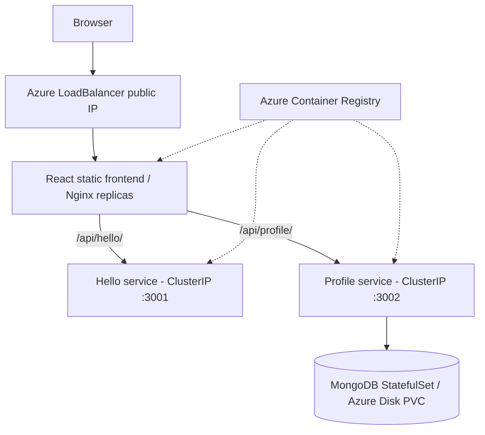

# AKS architecture

- AKS is managed Kubernetes. Frontend is the only public-facing service.
- MongoDB uses one replica with a persistent volume; this is **not** a production HA database.
- Plain HTTP is used for this classroom demo. Production requires HTTPS/TLS, ingress, backup, monitoring and stronger security controls.
